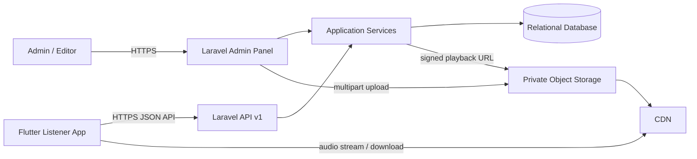
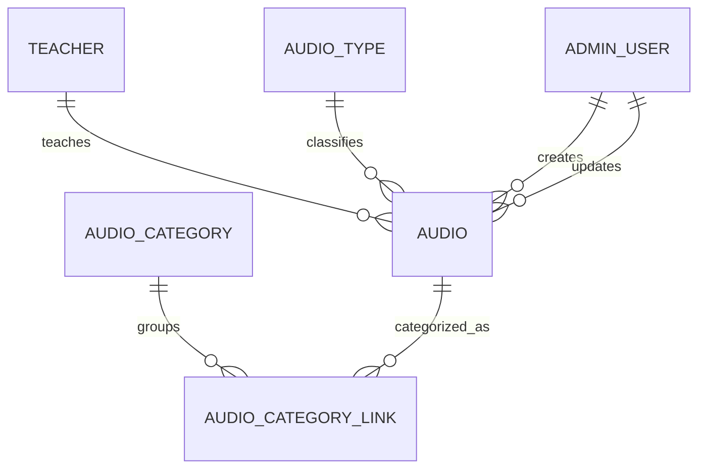

# Buddha Audio Project — Architecture

## 1. ရည်ရွယ်ချက်နှင့် အခြေခံရွေးချယ်မှုများ

ဤ project သည် တရားတော်/ဓမ္မအသံများကို စီမံခန့်ခွဲနိုင်သော Laravel backend နှင့် နားထောင်သူများအတွက် Flutter mobile app ပါဝင်သည့် system ဖြစ်သည်။ Admin က backend မှ ဆရာတော်၊ category၊ အမျိုးအစားနှင့် audio များကို စီမံပြီး၊ mobile app က API မှတစ်ဆင့် ရှာဖွေ၊ ဖွင့်နားထောင်၊ download လုပ်နိုင်မည်။

- Mobile: Flutter, Riverpod state management, repository-based data access.
- Backend: Laravel modular monolith, versioned REST API, relational database.
- Audio files: object storage (S3-compatible) နှင့် CDN; database ထဲတွင် file ကိုယ်တိုင်မသိမ်းပါ။
- Database: PostgreSQL (သို့) MySQL; ပထမ deployment အတွက် တစ်မျိုးကိုရွေး၍ migration များဖြင့် schema ကို ထိန်းသိမ်းပါ။
- Admin: Laravel backend ပေါ်ရှိ web admin panel။ MVP တွင် Laravel Blade/Livewire သို့မဟုတ် ရှိပြီးသား admin framework တစ်ခုကို အသုံးပြုနိုင်သည်။
- “riverpob” ကို Flutter `Riverpod` ဟု အဓိပ္ပာယ်ယူထားသည်။

## 2. System context

Laravel ကို အစပိုင်းတွင် service ခွဲများစွာမခွဲဘဲ deploy လုပ်ရလွယ်ကူသော modular monolith အဖြစ်ထားမည်။ Domain boundary များကို code အတွင်း သီးခြားထားပြီး လိုအပ်လာမှသာ queue worker၊ search service သို့မဟုတ် သီးခြား service များ ခွဲထုတ်မည်။

## 3. Domain model

အဓိက entity များနှင့် ဆက်နွယ်မှုများမှာ—

- **Teacher**: ဆရာတော်၏ အမည်၊ အမည်အတို/ရှာဖွေရန်အမည်၊ biography၊ ဓာတ်ပုံ၊ ဖော်ပြရန်အစီအစဉ်နှင့် active status။
- **Audio**: ခေါင်းစဉ်၊ အကျဉ်းချုပ်၊ teacher တစ်ပါး၊ type တစ်ခု၊ duration၊ language၊ publish status၊ publish date၊ cover image၊ audio object key၊ file format၊ file size၊ created/updated by။
- **AudioCategory**: အက်ပ်တွင် filter လုပ်ရန် category (ဥပမာ တရားတော်၊ ပရိတ်၊ ပဋ္ဌာန်း)။ Audio တစ်ခုကို category အများအပြား ချိတ်ဆက်နိုင်ရန် many-to-many သုံးမည်။
- **AudioType**: admin က ရွေးပေးသည့် အမျိုးအစား (ဥပမာ တရားနာ၊ ရွတ်ဖတ်၊ ဆွေးနွေးချက်)။ လုပ်ငန်းလိုအပ်ချက်က category နဲ့ တူညီသည်ဟု အတည်ပြုလျှင် နောက်ပိုင်းတွင် ပေါင်းစည်းနိုင်သည်။
- **AdminUser**: admin/editor role၊ authentication၊ audit timestamps။ နားထောင်သူအတွက် account မလိုသေးလျှင် public app access ကို guest အဖြစ်ထားနိုင်သည်။
- **PlaybackEvent** (နောက်ပိုင်း version): audio_id, user/device identifier, position, event time; analytics လိုအပ်လာသည့်အခါ ထည့်ပါ။ MVP တွင် နားထောင်မှုတိုင်းကို မဖြစ်မနေ log မလုပ်ပါ။

`Audio` တွင် `draft`, `processing`, `published`, `archived` status သုံးမည်။ Public API သည် `published` ဖြစ်ပြီး publish အတွက်လိုအပ်သော metadata နှင့် valid audio asset ရှိသည့် record များကိုသာ ပြန်ပေးမည်။ `slug` သို့မဟုတ် public UUID ကို API identifier အဖြစ်သုံးပြီး database ID ကို client contract ထဲ မဖော်ပြရန် အကြံပြုသည်။

## 4. Admin မှ upload/publish flow

1. Admin သည် login ဝင်ပြီး role အလိုက် ခွင့်ပြုထားသော စာမျက်နှာများကိုသာ ဝင်ရောက်မည်။
2. ဆရာတော်၊ category နှင့် type များကို အရင်ဖန်တီး/ပြင်ဆင်မည်။ Inactive ဖြစ်သော ရွေးချယ်စရာများကို audio အသစ်တွင် မရွေးနိုင်စေပါ။
3. Audio form တွင် title, description, teacher, category အများအပြား, type, language, cover, audio file တို့ကို ဖြည့်/ရွေးမည်။ Draft အဖြစ်သိမ်းနိုင်ပြီး publish validation အောင်မှသာ publish လုပ်မည်။
4. Server သည် extension တစ်ခုတည်းကို မယုံဘဲ MIME/type, size limit, audio decode/metadata ကို စစ်မည်။ File ကို private staging key ဖြင့် object storage သို့တင်ပြီး metadata ကို `processing` အဖြစ်သိမ်းမည်။
5. Queue job သည် audio metadata (အနည်းဆုံး duration/format) ကို ဖတ်စစ်ပြီး playback object နှင့် database state ကို ပြင်ဆင်မည်။ Transcoding လိုအပ်ပါက နောက်ပိုင်းအဆင့်တွင် queue ထဲထည့်မည်။
6. မှန်ကန်သော file နှင့် လိုအပ်သော metadata ရှိမှ editor/admin က publish လုပ်မည်။ Publish ပြီးနောက် public API တွင် ပေါ်လာမည်။ ဖယ်ရှားရာတွင် archive/soft delete ကို ဦးစွာလုပ်ပြီး storage file ကို ချက်ချင်းမဖျက်ပါ။

Upload ကို request တစ်ခုထဲတွင် အမြဲတမ်း ကြာကြာပို့မည့်အစား အရွယ်အစားကြီးလာလျှင် signed multipart/direct-to-object-storage upload သို့ ပြောင်းနိုင်အောင် storage interface ကို သီးခြားထားပါ။ MVP အတွက် Laravel မှ private storage သို့ streamed upload လုပ်ခြင်းဖြင့် စတင်နိုင်သည်။

## 5. Listener app flow

- Home: latest published audio, ဆရာတော်များ၊ category/type filters။
- Browse: category, teacher, type, search keyword, pagination ပါသော audio list။ Filter များကို server ဘက်တွင်လုပ်မည်။
- Detail: ခေါင်းစဉ်၊ ဆရာတော်၊ category/type၊ ကြာချိန်၊ description နှင့် play/download action။
- Player: play/pause, seek, buffering/error state, background playback, lock-screen controls, playback speed (လိုအပ်ချက်အလိုက်)။ Audio ကို streaming အဖြစ် စတင်ပြီး download/offline သိမ်းမှုကို ဒုတိယအဆင့်တွင် ထည့်နိုင်သည်။
- Riverpod: API client provider → repository provider → feature providers/notifiers → UI။ Widget များက HTTP client ကို တိုက်ရိုက်မခေါ်စေရ။ `AudioRepository`, `TeacherRepository`, `TaxonomyRepository` တို့ဖြင့် data access ကို စုစည်းမည်။
- Audio playback engine ကို `AudioPlayerController` interface နောက်ကွယ်ထားပြီး app state (current item, queue, position, buffering, error) ကို သီးခြား provider က ထိန်းမည်။ UI lifecycle နှင့် player lifecycle ကို မရောထွေးစေရ။

## 6. API outline (`/api/v1`)

Public read endpoints:

- `GET /home` — home sections နှင့် featured/latest items.
- `GET /audios?query=&teacher=&category=&type=&cursor=` — filter/search/paginated list.
- `GET /audios/{slug}` — detail.
- `GET /teachers`၊ `GET /teachers/{slug}`။
- `GET /categories` နှင့် `GET /audio-types`။
- `POST /audios/{slug}/playback-url` (လိုအပ်ပါက) — short-lived signed stream URL ပြန်ပေးရန်။ Public content အတွက် CDN URL ကို တိုက်ရိုက်ပေးနိုင်သော်လည်း private/unpublished file များကို public မဖော်ပြရ။

Web panel ကို အသုံးပြုလျှင် form/action များသည် Laravel service များနှင့် တိုက်ရိုက်ချိတ်ဆက်မည်။ Mobile မှ admin လုပ်ရန် လိုအပ်လာမှသာ အောက်ပါ `/admin/v1` API ကို ထပ်ထည့်မည်။ MVP တွင် မဖြစ်မနေ မလိုအပ်ပါ။

- `POST/PUT /admin/teachers`, `/admin/categories`, `/admin/audio-types`
- `POST /admin/audios` (draft metadata), `POST /admin/audios/{id}/upload`, `PUT /admin/audios/{id}`, `POST /admin/audios/{id}/publish`, `POST /admin/audios/{id}/archive`

API response တွင် stable JSON envelope၊ `data`, `meta.pagination`, field validation errors ပါဝင်မည်။ Search/filter/sort အတွက် allowlist သတ်မှတ်ပြီး client ထံမှ SQL column သို့မဟုတ် arbitrary sort expression မယူရ။

## 7. Backend module boundary

Laravel code ကို အောက်ပါ feature boundary အလိုက် စီမည် (တကယ့် folder convention ကို project စတင်ချိန်တွင် ရွေးနိုင်သည်)—

- **Catalog**: teacher, category, audio type CRUD/read models။
- **Audio**: metadata, draft/publish/archive lifecycle, validation။
- **Media**: upload, storage adapter, signed URLs, metadata extraction။
- **Admin/Auth**: login, roles/policies, audit history။
- **Public API**: read-only published catalog, pagination/filter serialization။
- **Jobs**: media inspection/transcoding, retry/failure handling။

Controller များသည် HTTP validation/response ကိုသာ ကိုင်တွယ်ပြီး business rule ကို service/action နှင့် policy ထဲထားမည်။ Database constraints (foreign keys, unique slug, indexes) နှင့် request validation နှစ်မျိုးလုံး သုံးမည်။

## 8. Visual design direction

အဓိက color ကို သင်္ကန်း၏ saffron/ochre အရောင်အုပ်စုမှ ရွေးမည်။ ဥပမာ primary `#B96A2C`, dark `#70401F`, light background `#FFF8EE`, text `#28231F`။ ဤအရောင်များသည် စတင်ရန် palette သာဖြစ်ပြီး brand/ဆရာတော်အဖွဲ့၏ အတည်ပြုချက်အရ ပြင်ဆင်နိုင်သည်။ Contrast ပြည့်မီမှုကို စစ်ပြီး primary color ကို body text အားလုံးတွင် မသုံးဘဲ action/highlight အတွက်သုံးမည်။ Flutter တွင် Material 3 `ColorScheme` တစ်ခုအဖြစ် သတ်မှတ်ပြီး admin နှင့် mobile တွင် တူညီသော design token များကို အသုံးပြုမည်။

## 9. Security, reliability, and operations

- Admin routes တွင် authentication, role/policy check, CSRF protection (web), rate limit နှင့် audit logging ထည့်ပါ။
- Upload တွင် size/type validation, random object keys, private bucket, malware scanning policy (hosting ပံ့ပိုးလျှင်)။ User-provided filename ကို storage key မလုပ်ရ။
- Secrets ကို environment/secret manager ထဲထားပြီး repository ထဲမထည့်ရ။ Production တွင် HTTPS မဖြစ်မနေသုံးပါ။
- Public API မှ draft/archived record သို့မဟုတ် internal storage path မပေါက်ကြားစေရ။ Signed URL သုံးလျှင် expiry တိုတောင်းစေပါ။
- DB backup နှင့် object storage lifecycle/backup policy ကို သတ်မှတ်ပါ။ Soft delete/archive နှင့် physical media deletion ကို စီမံခန့်ခွဲမှုအရ သီးခြားလုပ်ပါ။
- Logs တွင် request ID, upload/job status ပါစေ; token, signed URL, အရေးကြီး metadata များကို မရေးပါ။ Queue job မအောင်မြင်မှုနှင့် storage error များကို monitoring လုပ်ပါ။

## 10. Deployment shape

MVP production topology: Flutter builds → App Store/Play Store; Laravel app/API + admin web → managed app runtime; managed PostgreSQL/MySQL; private S3-compatible object storage; CDN for published audio; queue worker + Redis/database queue for media jobs. Local development တွင် Docker Compose ဖြင့် Laravel, database, queue နှင့် S3-compatible local storage ကို တစ်စုတစ်စည်းတည်း run လုပ်နိုင်သည်။ Environment များကို local/staging/production ခွဲပြီး migration များကို release အစီအစဉ်နှင့် လုပ်ပါ။

## 11. Suggested delivery sequence

1. **Foundation**: repository/app setup, environment config, schema/migrations, admin authentication/roles, palette/design tokens။
2. **Catalog admin**: teacher/category/type CRUD နှင့် active/inactive state။
3. **Audio admin**: draft form, upload/storage, metadata inspection, publish/archive။
4. **Public API**: home/list/detail/filter/pagination နှင့် API documentation။
5. **Flutter MVP**: Riverpod/API repositories, browse/detail, audio player, error/loading/empty states။
6. **Release hardening**: signed URLs/CDN, monitoring/backups, accessibility, store setup; offline playback/search optimization ကို usage လိုအပ်ချက်အရ ဆက်တိုးပါ။

## 12. MVP acceptance criteria

- Admin က ဆရာတော်၊ category နှင့် audio type ကို စီမံနိုင်သည်။
- Admin က metadata ဖြည့်၍ audio တင်နိုင်၊ draft သိမ်းနိုင်၊ valid ဖြစ်မှ publish လုပ်နိုင်သည်။
- Public API သည် published audio များကို ဆရာတော်/category/type/search ဖြင့် filter လုပ်ပေးသည်။
- Flutter app က catalog ကို ပြပြီး audio ကို stream ဖွင့်နားထောင်နိုင်သည်; loading, empty, network/audio error state များ ရှင်းလင်းသည်။
- Draft/archived audio နှင့် private storage key များကို public client မရနိုင်ပါ။
- Admin mutation များကို မည်သူလုပ်ခဲ့သည်ကို audit လုပ်နိုင်သည်။

## 13. Decisions to confirm before implementation

Architecture အပေါ် အခြေခံထားသော assumption များ—guest listener အဖြစ်စတင်ခြင်း၊ audio တစ်ခုတွင် ဆရာတော်တစ်ပါး သတ်မှတ်ခြင်း၊ category များစွာခွင့်ပြုပြီး type တစ်ခု သတ်မှတ်ခြင်း၊ web admin အသုံးပြုခြင်း၊ published audio ကို CDN မှ stream လုပ်ခြင်း။ Product requirement မတူပါက schema/API implementation မစမီ ပြင်ဆင်ရမည်။
